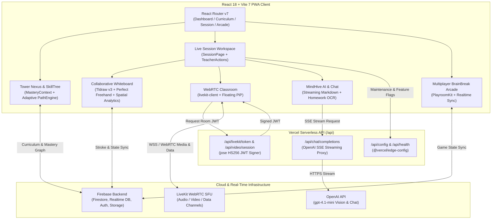

# Tower Tutoring App (`tower-tutoring-app`)

## 1. Executive Summary

**Tower Tutoring App** (Tower Nexus) is an interactive, real-time STEM tutoring and adaptive learning platform designed for K–12 and competitive mathematics mastery. Combining low-latency WebRTC video classrooms with synchronized multi-user infinite whiteboards, AI-guided tutoring, and gamified skill-tree progression, Tower Nexus unifies live 1-on-1 instruction and autonomous practice in a single browser workspace.

Built on **React 18** and **Vite 7**, the application pairs **LiveKit WebRTC** audio/video rooms with **Tldraw v3** canvas synchronization, **Firebase** (Firestore, Realtime Database, Storage, Authentication) for state persistence, and streaming **OpenAI** (`@ai-sdk/openai` + Vercel Serverless Functions) for real-time pedagogical feedback, stroke analysis, and visual homework OCR.

---

## 2. Architecture Diagram



---

## 3. Key Engineering Highlights

- **Synchronized Tldraw v3 Whiteboard & Spatial Analytics**: Built on `@tldraw/tldraw` and `perfect-freehand`, enhanced with custom hooks (`useWhiteboardSync`, `useWhiteboardActions`, `useLiveObservation`) and spatial awareness utilities (`StrokeAnalytics`, `WhiteboardSpatialAwareness`, `WhiteboardCapture`) that capture canvas regions via `html2canvas` for AI inspection.
- **Low-Latency LiveKit WebRTC Classrooms**: Serverless token provisioning (`api/_livekit.js`, `api/livekit/token.js`) signs cryptographic room tokens via `jose` (`HS256`) with granular publish/subscribe/data capabilities and automatic local dev-mode fallback.
- **MindHive AI Tutor & Homework OCR Pipeline**: Streaming SSE proxy (`api/chat/completions.js`) powered by OpenAI (`gpt-4.1-mini` / `@ai-sdk/openai`) paired with `MindHiveService`, `MindHivePlugins`, and `OCRService` to parse uploaded homework (`useHomeworkUpload`) and deliver step-by-step Socratic hints in `visualize`, `guide`, and `train` adaptive modes.
- **Dual-Database Firebase Persistence**: Combines **Cloud Firestore** for structured curriculum nodes, user profiles, and mastery tracking (`MasteryContext`, `CurriculumData`) with **Firebase Realtime Database** and **PlayroomKit** for sub-100ms multiplayer game synchronization (`Battleship`, `AirHockey`, `Checkers`, `Connect4`, `SwipeFight`).
- **Resilient Edge Delivery & PWA Architecture**: Configured with `vite-plugin-pwa`, `<SystemStabilizer />` error boundaries, lazy-loaded route bundles, and Vercel Edge Config (`@vercel/edge-config`) for zero-downtime maintenance toggles and immutable asset caching.

---

## 4. Repository Structure

```text
tower-tutoring-app/
├── api/                          # Vercel Serverless Functions
│   ├── _livekit.js               # LiveKit JWT token signing & config helper (jose)
│   ├── avatar/hero.js            # Dynamic learner avatar endpoint
│   ├── chat/completions.js       # OpenAI streaming SSE chat proxy
│   ├── config.js                 # Edge runtime configuration & maintenance flags
│   ├── health.js                 # Service healthcheck endpoint
│   ├── livekit/token.js          # LiveKit room token issuer
│   └── video/session.js          # Video session orchestration endpoint
├── src/
│   ├── components/               # Shared UI & resilience primitives
│   │   ├── ErrorBoundary.jsx     # Fault isolation boundary
│   │   ├── SystemStabilizer.jsx  # Runtime stability wrapper
│   │   ├── WhiteboardOverlay.jsx # Tldraw HUD & annotation overlay
│   │   └── SimplifiedToolbar.jsx # Custom drawing controls
│   ├── context/                  # Global React providers
│   │   ├── AuthContext.jsx       # Firebase authentication state
│   │   └── MasteryContext.jsx    # Skill tree progression & mastery state
│   ├── data/
│   │   └── CurriculumData.js     # Directed acyclic graph of math skills
│   ├── features/                 # Domain-driven feature modules
│   │   ├── chat/                 # Streaming AI chat UI (ChatGPTChat)
│   │   ├── dashboard/            # TowerNexus, SkillTree, AssessmentCenter, SpeedMath
│   │   ├── games/                # BrainBreak arcade (Battleship, AirHockey, Checkers, Connect4)
│   │   ├── profile/              # Learner profile & analytics
│   │   ├── session/              # Whiteboard, VideoChat, PathEngine, MindHiveInterface
│   │   └── tools/                # Interactive calculators & MathTools
│   ├── hooks/                    # Custom React hooks (whiteboard sync, haptics, WebRTC, games)
│   ├── layouts/                  # SessionLayout wrapper
│   ├── pages/                    # Route entrypoints (SessionPage.jsx)
│   ├── services/                 # Firebase init, MindHiveService, OCRService
│   └── utils/                    # StrokeAnalytics, WhiteboardCapture, SpatialAwareness
├── firebase.json                 # Firebase Hosting, Firestore & RTDB rules config
├── firestore.rules               # Cloud Firestore security rules
├── database.rules.json           # Firebase Realtime Database security rules
├── storage.rules                 # Cloud Storage security rules
├── vercel.json                   # Vercel headers, caching & SPA rewrites
├── vite.config.js                # Vite 7 + React + PWA build configuration
└── package.json                  # Project dependencies & scripts (Node >=22 <26)
```

---

## 5. Local Setup & Development

### Prerequisites

- **Node.js**: `>=22 <26` (per `package.json` engines)
- **npm**: `>=10`
- **Firebase Project**: Firestore, Realtime Database, Authentication, and Storage enabled
- **LiveKit Server / Cloud**: API key, secret, and WebSocket URL
- **OpenAI API Key**: For MindHive AI chat and vision OCR endpoints

### 1. Install Dependencies

```bash
npm install
```

### 2. Configure Environment Variables

Create a `.env.local` file in the project root (automatically ignored by git):

```dotenv
# Firebase Client SDK Configuration
VITE_FIREBASE_API_KEY=your_firebase_api_key
VITE_FIREBASE_AUTH_DOMAIN=your_project.firebaseapp.com
VITE_FIREBASE_DATABASE_URL=https://your_project-default-rtdb.firebaseio.com
VITE_FIREBASE_PROJECT_ID=your_project_id
VITE_FIREBASE_STORAGE_BUCKET=your_project.appspot.com
VITE_FIREBASE_MESSAGING_SENDER_ID=your_sender_id
VITE_FIREBASE_APP_ID=your_app_id

# LiveKit WebRTC Configuration
VITE_LIVEKIT_URL=wss://your-livekit-host.livekit.cloud
LIVEKIT_URL=wss://your-livekit-host.livekit.cloud
LIVEKIT_API_KEY=your_livekit_api_key
LIVEKIT_API_SECRET=your_livekit_api_secret

# OpenAI API Configuration (Serverless API)
OPENAI_API_KEY=sk-your_openai_api_key
OPENAI_MODEL=gpt-4.1-mini
```

### 3. Run Development Server

```bash
npm run dev
```

To test Vercel serverless functions (`/api/*`) locally alongside the Vite frontend:

```bash
npx vercel dev
```

### 4. Production Build & Verification

```bash
npm run lint
npm run build
npm run preview
```
